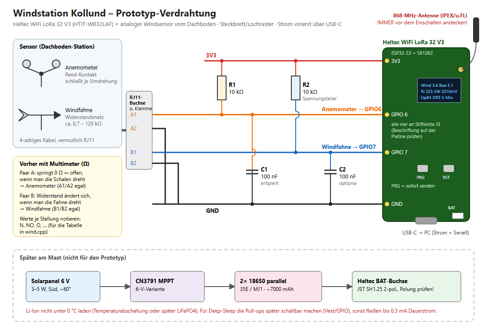

# Windstation Kollund – Prototyp

Heltec WiFi LoRa 32 V3 (HTIT-WB32LAF) liest ein Reed-Anemometer und eine Windfahne (Widerstandsnetz)
aus und sendet Minutenwerte per LoRaWAN an TTN.



## Reihenfolge

1. **Sensor ausmessen** (Multimeter, Ohm): Welches Aderpaar springt beim Drehen der Schalen zwischen 0 Ω und offen
   (= Anemometer), welches ändert den Widerstand beim Drehen der Fahne (= Windfahne)? Notiere je Stellung den Wert.
2. **Verdrahten** wie in der Skizze: Anemometer an GPIO6, Windfahne an GPIO7, je 10 kΩ nach 3V3, 100 nF an GPIO6.
3. **Sensortest ohne Funk:**
   ```
   pio run -e sensortest -t upload -t monitor
   ```
   Pro Sekunde kommt eine Zeile `Pulse/s | Hz | m/s | Böe | Fahne mV | Index | Abw. mV | Richtung`.
   - Schalen drehen: Pulse zählen hoch. Eine Umdrehung = 1 Puls (Misol) bzw. so viele, wie der Reed schaltet.
   - Fahne langsam in alle 16 Richtungen drehen: `Abw. mV` sollte klein sein (< 50). Ist es groß, passt die
     Tabelle in `src/wind.cpp` nicht. Dann die gemessenen mV bzw. Widerstände eintragen.
4. **Antenne anstecken** (IPEX). Ohne Antenne nie mit Funk starten.
5. **TTN:** Application und End Device anlegen (manuell, Europe 863-870 MHz SF9,
   *LoRaWAN Specification 1.1.0*, *RP001 Regional Parameters 1.1 revision A*), DevEUI/JoinEUI/AppKey/NwkKey
   generieren und in `src/secrets.h` eintragen (Vorlage `secrets.h.example`).
   Payload-Formatter: `ttn/payload-formatter.js` als „Custom JavaScript formatter“.
6. **LoRaWAN-Test:**
   ```
   pio run -e lorawan -t upload -t monitor
   ```
   Nach dem Join folgt der 1. Uplink nach 15 s mit LinkCheck (Gateway-Anzahl + Reserve in dB), danach alle 5 min.
   **PRG-Taste** = sofort senden + LinkCheck (für Reichweitentests, max. alle 30 s; jeder LinkCheck kostet einen
   der 10 TTN-Downlinks pro Tag).

## Konfiguration

`src/config.h`: Pins, Anemometer-Faktor (`ANEMO_MS_PER_HZ`), Pull-up, Nordabgleich (`VANE_OFFSET_DEG`),
Sendeintervall. Die Akkuspannung (`VBAT_CTRL_ON`) zeigt bei V3.2-Boards 0 V an. Dann auf `HIGH` stellen.
